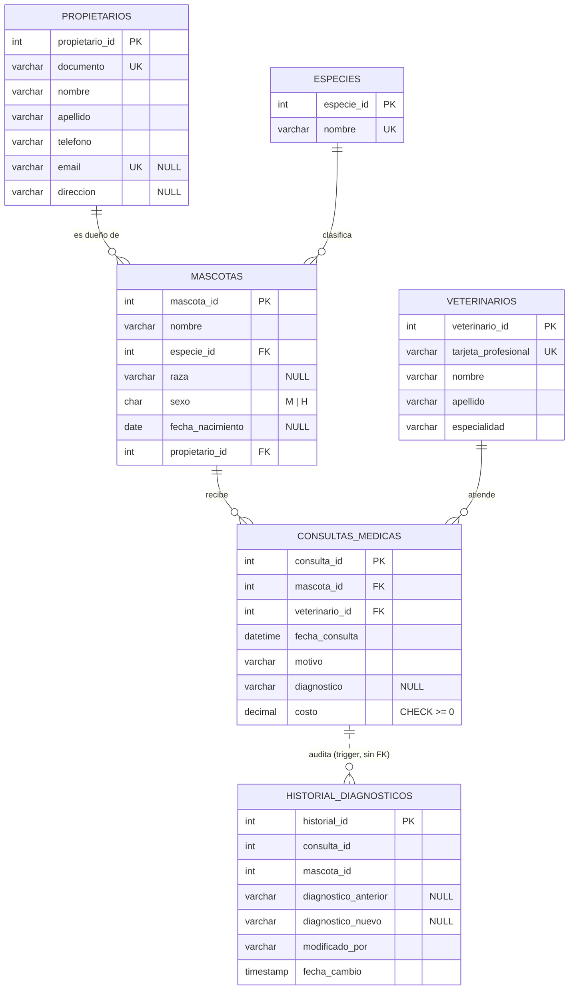

# Modelo lógico y normalización · Clínica Veterinaria "Huellas"

Punto 1 del parcial. La implementación está en [`sql/parcial_veterinaria.sql`](../sql/parcial_veterinaria.sql).

## Diagrama entidad-relación

## Relaciones

| Relación | Tipo | Cómo se implementa |
|---|---|---|
| Propietario → Mascotas | 1:N | `mascotas.propietario_id` FK |
| Especie → Mascotas | 1:N | `mascotas.especie_id` FK |
| Mascotas ↔ Veterinarios | **N:M** | Tabla intermedia `consultas_medicas`, que además guarda los datos propios de cada atención (fecha, motivo, diagnóstico, costo) |
| Consulta → Historial | 1:N lógica | `historial_diagnosticos.consulta_id` **sin FK**, a propósito: la auditoría debe sobrevivir aunque la consulta se borre |

## Normalización

Si se partiera de una sola tabla "planilla de consultas", cada fila repetiría los datos del dueño, de la mascota, de su especie y del veterinario. Así se llega a las tablas finales:

**1FN: valores atómicos, sin grupos repetidos**
- `nombre` y `apellido` en columnas separadas, y un teléfono por propietario.
- Cada consulta es una fila. No hay columnas como `consulta1`, `consulta2`…

**2FN: sin dependencias parciales**
- En la planilla, la clave sería (mascota, veterinario, fecha). El nombre del dueño depende solo de la mascota y la especialidad solo del veterinario, así que se separan en `mascotas`, `propietarios` y `veterinarios`.
- Todas las tablas finales tienen clave primaria simple (`AUTO_INCREMENT`), por lo que cumplen 2FN directamente.

**3FN: sin dependencias transitivas**
- `mascota → especie → nombre de la especie`: la especie pasa a su propia tabla, `especies`. Así "Perro" se escribe una sola vez y no puede quedar como "perro" o "Perr0" en otra fila.
- `propietario → teléfono`: el teléfono vive en `propietarios`, no se copia en cada mascota ni en cada consulta.
- **No se guarda la edad.** Depende de `fecha_nacimiento` y de la fecha actual, y almacenarla crearía un dato que se desactualiza. Se calcula al consultar con `TIMESTAMPDIFF(YEAR, fecha_nacimiento, CURDATE())`, que es lo que recibe `fn_etapa_vida`.

**Claves candidatas protegidas con `UNIQUE`:** `propietarios.documento`, `propietarios.email`, `veterinarios.tarjeta_profesional` y `especies.nombre`.
