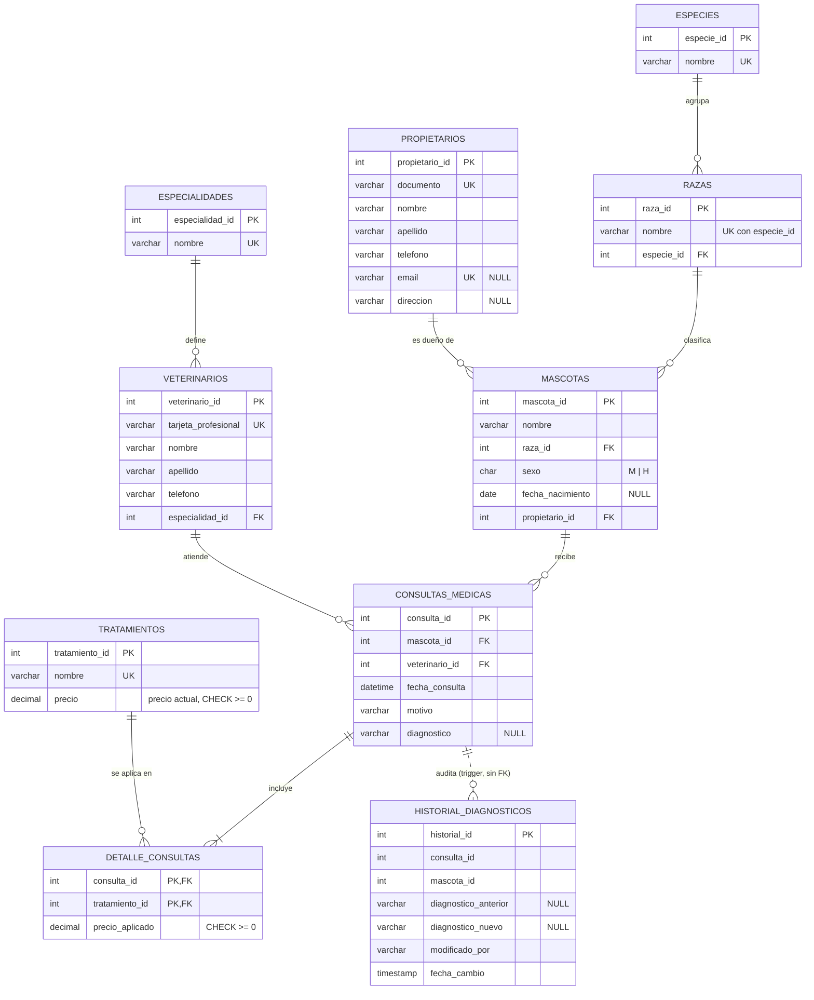

# Modelo lógico y normalización · Clínica Veterinaria "Huellas"

Punto 1 del parcial. La implementación está en [`sql/parcial_veterinaria.sql`](../sql/parcial_veterinaria.sql).

## Diagrama entidad-relación

## Relaciones

| Relación | Tipo | Cómo se implementa |
|---|---|---|
| Especie → Razas | 1:N | `razas.especie_id` FK |
| Raza → Mascotas | 1:N | `mascotas.raza_id` FK |
| Propietario → Mascotas | 1:N | `mascotas.propietario_id` FK |
| Especialidad → Veterinarios | 1:N | `veterinarios.especialidad_id` FK |
| Mascotas ↔ Veterinarios | **N:M** | Tabla `consultas_medicas`, que además guarda los datos de cada atención (fecha, motivo, diagnóstico) |
| Consultas ↔ Tratamientos | **N:M** | Tabla `detalle_consultas` con **PK compuesta** `(consulta_id, tratamiento_id)`: un mismo tratamiento no se repite en una consulta |
| Consulta → Historial | 1:N lógica | `historial_diagnosticos.consulta_id` **sin FK**, a propósito: la auditoría debe sobrevivir aunque la consulta se borre |

## Normalización

Si se partiera de una sola "planilla de consultas", cada fila repetiría los datos del dueño, de la mascota, su raza y especie, del veterinario y su especialidad, y una lista de tratamientos con precios. Así se llega a las 9 tablas:

**1FN: valores atómicos, sin grupos repetidos**
- La lista de tratamientos de una consulta es un grupo repetido. Pasa a `detalle_consultas`, con una fila por tratamiento.
- `nombre` y `apellido` van en columnas separadas, y el título ("Dr.") no se guarda dentro del nombre.

**2FN: sin dependencias parciales**
- `detalle_consultas` es la única tabla con PK compuesta. Sus atributos dependen de la clave completa:
  - `precio_aplicado` depende de la consulta **y** del tratamiento: es lo que se cobró por ese tratamiento en esa consulta.
  - El nombre del tratamiento depende solo de `tratamiento_id`, así que se queda en `tratamientos`.
- Las demás tablas tienen PK simple (`AUTO_INCREMENT`) y cumplen 2FN directamente.

**3FN: sin dependencias transitivas**
- **`mascota → raza → especie`:** `mascotas` guarda solo `raza_id`. Si también guardara `especie_id`, una mascota podría quedar como "Siamés" y "Perro" a la vez.
- **`veterinario → especialidad → nombre de la especialidad`:** pasa a la tabla `especialidades`.
- **`propietario → teléfono`:** el teléfono vive en `propietarios` y no se copia en cada mascota.
- **No se guardan datos derivados:**
  - La **edad** se calcula con `TIMESTAMPDIFF(YEAR, fecha_nacimiento, CURDATE())`.
  - El **total de una consulta** se calcula con `SUM(precio_aplicado)`. Guardarlo permitiría que no coincidiera con su detalle.

**¿Por qué `precio_aplicado` no es redundante con `tratamientos.precio`?** Porque son datos distintos. `tratamientos.precio` es el precio **actual** de lista; `precio_aplicado` es lo que **se cobró ese día**. En los datos de prueba, la consulta 1 se cobró a 45.000 y hoy la consulta general vale 50.000. Si se calculara desde el precio actual, cada cambio de precio alteraría las facturas pasadas.

**Claves candidatas protegidas con `UNIQUE`:**
- `propietarios.documento` y `propietarios.email`.
- `veterinarios.tarjeta_profesional`.
- El nombre en `especies`, `especialidades` y `tratamientos`.
- `(especie_id, nombre)` en `razas`, porque "Criollo" puede existir en varias especies.
